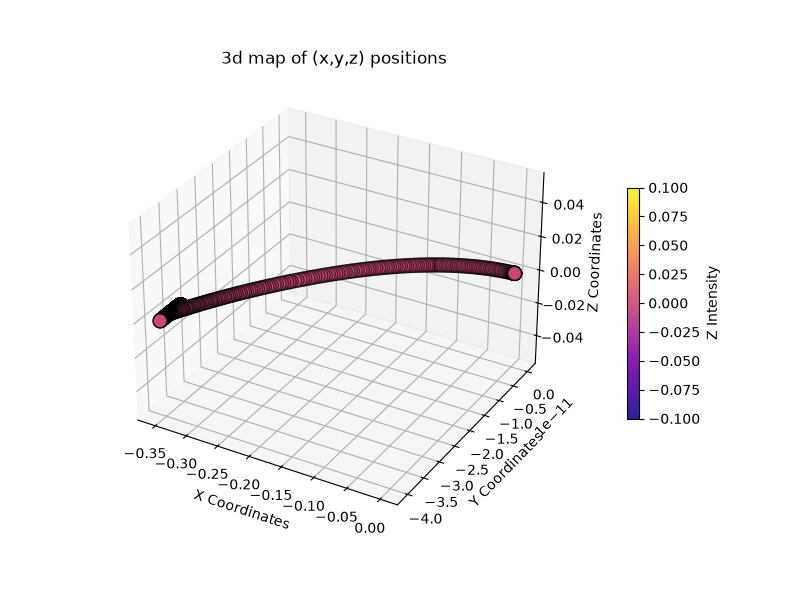
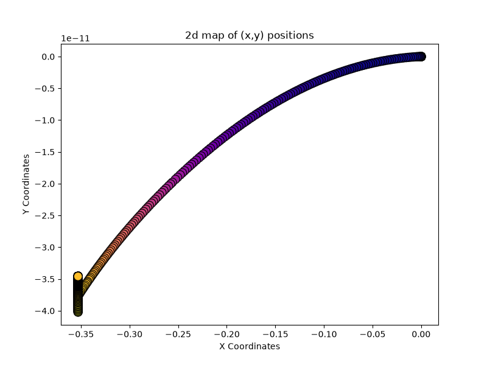
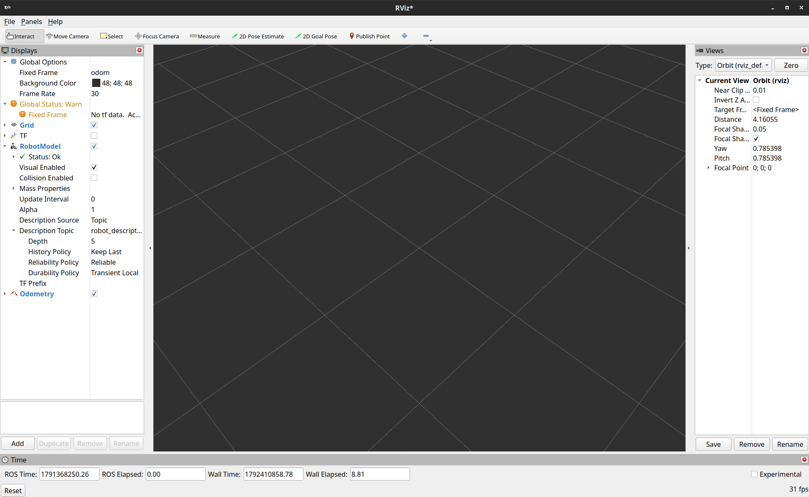
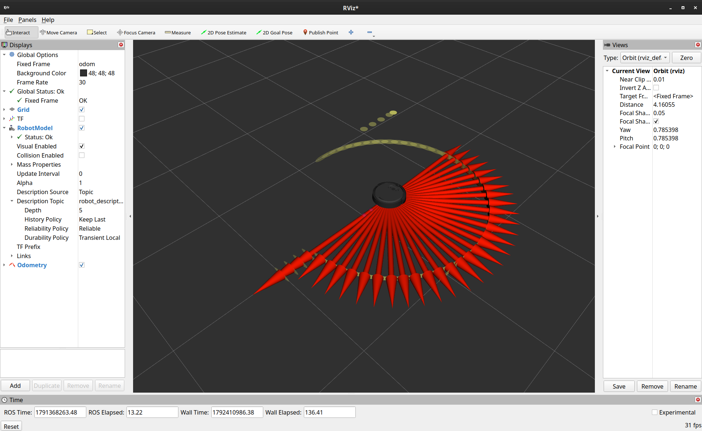
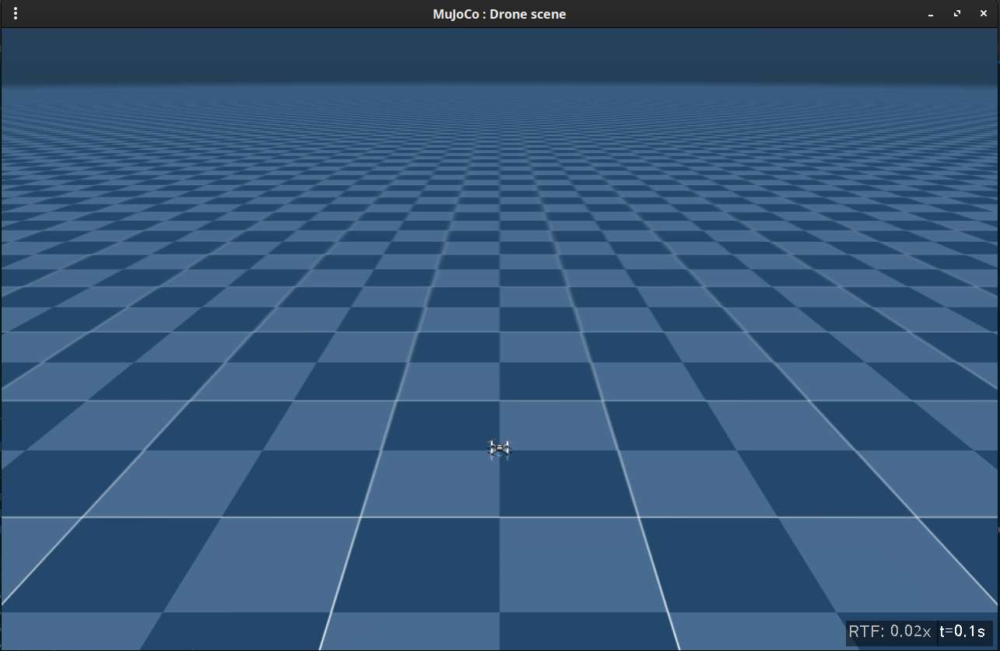

> Note: there is a significant section on **headless running** in this post.  [Click here](#headless) to jump directly to it.

# Logging and Analyzing Data

Our experiments will involve a reasonable amount of log analysis to understand what the robot is doing and how well it is satisfying its objectives.

> For the logging we'll focus solely on the Create, leaving logging in the CrazyFlie up to you.  However, there will be a short section on running the [Crazyflie headless at the end](#crazyflie-headless).
{: .prompt-tip }

> We also will be following the [Jazzy guide for logging](https://docs.ros.org/en/jazzy/Tutorials/Demos/Logging-and-logger-configuration.html).  
{: .prompt-tip }

Now, one thing you should consider as you setup your missions is *what* exactly needs to be logged.  Do you need the position/rotation every single frame, or can it be averaged to save on space?  Are we monitoring requirements satisfaction at run time?  Is there some intermediate value that needs to be calculated?

Moreover, what format will you store it in?

Logging to a file sounds onerous, however if you try to pack all your data into an object of some sort your project will balloon in RAM usage and slow down even further, so we'll write data to disk.  (We're assuming that we have a lot of data -- if there isn't that much then you don't necessarily *need* to log to file).

I tend to prefer manually-managing a file of comma-separated values (CSV) that is easy to post-process for statistical analyses, so that's what we'll do here.  

The roboticists might be wondering about replay and seeing what actually happened during the run.  We'll use [ROS bags](https://wiki.ros.org/Bags) to manage that.

## Logging with the Create 3

Let's use our prior create3 `undock_and_talk.py` file as a basis, since it already has a bunch of tasks.  We'll add another one (navigate to a waypoint) and log how close we are to that waypoint.  

Note that ROS supports multiple logging directions, including to the console, to disk, and to a ROS topic.  If you're logging to a file and you're on a *physical* robot you'll need to keep in mind that space is often limited!

### Our (planned) data layout

Here's the format we'll follow for our log files **in this script**.  There will be a header row and then the data.

> Pick a format that makes the most sense to you.  You don't even need a header row as long as you know what each column *is*, though they sure make data access cleaner with the `csv` library!
{: .prompt-tip }

```
Timestamp,posx,posy,posz,rotx,roty,rotz,rotw,distanceToWaypoint,missionComplete?
```

We'll come back to this after some intro bits.  The point here is that, for this script, we are interested in the robot's pose and its distance from the waypoint we want it to visit.  If we were monitoring requirements satisfaction then we might want to include utility values for each requirement at each timestep.


### Initial logs

First, let's do some "hello world" type things.  Let's log some basic messages when we start and when we receive an `/odom` message.

Look at `undock_and_talk.py`, right before `self.send_undock_goal()` within `__init__`.  You should see:

```python
self.get_logger().info('Create 3 Demo Node initialized. Undocking...')
```

That's sending a log message to your console with the `INFO` severity level.  Others include `ERROR`, `WARNING`, `DEBUG`, etc.

> Here's a link describing the other levels.  I didn't immediately notice a link for Jazzy, so what you see for Foxy should be relevant still [https://docs.ros.org/en/foxy/Tutorials/Demos/Logging-and-logger-configuration.html](https://docs.ros.org/en/foxy/Tutorials/Demos/Logging-and-logger-configuration.html).
{: .prompt-tip }

Interestingly, if you pop down to the `odom_callback` function you'll see something similar.  The logger is logging an `INFO` message to the console with the current pose.

That's it - you're logging to console already.  

**One further note** - you can also just use Python's `print` command to log to the console.  You just lose out on the official logging infrastructure.

I added a call to `print` just below the `self.get_logger().info()` call that prints out the pose on `/odom`:

```python
 self.get_logger().info(
    f"Pos: X={current_pose.pose.position.x:.2f}m, Y={current_pose.pose.position.y:.2f}m | "
    f"Rotation (Yaw): {yaw_degrees:.1f}°"
)
print(
    f"Python Print:: Pos: X={current_pose.pose.position.x:.2f}m, Y={current_pose.pose.position.y:.2f}m | "
    f"Rotation (Yaw): {yaw_degrees:.1f}°"
)
```

The output looks like this:

```bash
[INFO] [1790161347.605425192] [create3_demo_node]: Pos: X=-0.35m, Y=-0.00m | Rotation (Yaw): 64.7°
Python Print:: Pos: X=-0.35m, Y=-0.00m | Rotation (Yaw): 64.7°
[INFO] [1790161347.681340695] [create3_demo_node]: Pos: X=-0.35m, Y=-0.00m | Rotation (Yaw): 65.4°
Python Print:: Pos: X=-0.35m, Y=-0.00m | Rotation (Yaw): 65.4°
[INFO] [1790161347.751361828] [create3_demo_node]: Pos: X=-0.35m, Y=-0.00m | Rotation (Yaw): 66.2°
Python Print:: Pos: X=-0.35m, Y=-0.00m | Rotation (Yaw): 66.2°
```

> You can remove the print as it is redundant - but I wanted to show you what it looks like.

### Considerations prior to file logging

Consider your layout.  Right now we are running the robot on a simulator on our personal device.  Logging to file here would simply mean writing to a file on your device.

However, if the code is running on a physical robot you will more than likely not have much space.  For instance, if an Arduino is the brain then space is nearly non-existant.  If you're using a Raspberry Pi then space is not as limited, but file writes are a concern (i.e., writing to a microSD card over and over and over and over tends to burn them out quickly).

The solution, at least to me, is to advertise your relevant info to a special topic.  But, if we're simulating then it isn't a big deal.

> If you are planning on eventually moving to a physical robot, say, for a journal extension from a conference paper, then proactive coding might be a better idea.
{: .prompt-tip }

The **other** aspect, and this is the bigger one, is deciding *which* logging style to use.  You may have noticed there's a lot of additional information being output (the logging level, a bunch of square brackets, etc.).  You'll need to strip that out when you parse later (which can be done with a combination of `grep` and `sed`).  For ease of use we're just going to log via Python file writing, however if you want to use the standard ROS logging infrastructure it is a consideration.

### Writing to a file

For us, there are three options for logging to a file:

1. Use terminal redirect commands to simply write your terminal output to a file.
 
* Straightforward, but possible to miss information or include unnecessary information from the terminal.  You also have all the additional logging decorators.

2. Using Python file commands to write your own custom logs (i.e., no `logger`)

* Also straightforward, but you manage everything yourself -- not necessarily a bad thing!  (We'll mainly do this).  No need to strip out unnecessary characters, unless if you added them yourself.

3. Using the `logger` component to log to file.

* Exists by default, you just need to get used to the syntax of the `logger` component.  Also has the logging decorators.

Let's start by writing to a file with the `logger` component.  Note that I'll assume you know how to read/write files with Python already.  

---

Guess what, your logs are already being written to disk!  If you check the `~/.ros/log` directory you'll more than likely see a *ton* of logs.  

You can probably delete all of those unless if you've already run experiments and need to keep the information for analysis.  

First, let's create a log directory and a new environment variable.  I like to keep my logs near my experiment - you're welcome to make it wherever.

Inside `~/distrobox/jazzy/create3_ws`:

```bash
mkdir expr_logs
```

Then, in your `.bashrc` file, set the environment variable.  Note you'll need to update this for different experiments (or, if you go between the Crazyflie and Create 3).

```bash
export ROS_LOG_DIR=~/distrobox/jazzy/create3_ws/expr_logs/
```

> Make sure you re-source your `.bashrc` file in your open terminal windows.

Now, tweak your `undock_and_talk.py` file, as we need better exit handling to allow the logs to be properly written out.

Update your `main` function:

```python
def main(args=None):
    rclpy.init(args=args)
    node = Create3DemoNode()

    # allow Ctrl+C to gracefully shut things down so we don't miss our log writes
    try:
        rclpy.spin(node)
    except KeyboardInterrupt:
        pass
    finally:
        node.destroy_node()
        if rclpy.ok(): # make sure we're ready to shut down
            rclpy.shutdown() # gracefully close (and write logs)
```

The `try`-`except`-`finally` block is going to catch our `Ctrl+C` events to allow the node to shut down gracefully.  If you cancel without this, then your log files will most likely be empty!

Now, re-run your nodes as usual.  Check the new log directory and look at a log file.  It should look like this:

```bash
distrobox> ~/distrobox/jazzy/create3_ws$ ls expr_logs/
python3_64844_1790169597931.log
```

```bash
distrobox> ~/distrobox/jazzy/create3_ws$ cat expr_logs/python3_64844_1790169597931.log 
[INFO] [1790169598.064678135] [create3_demo_node]: Create 3 Demo Node initialized. Undocking...
[INFO] [1790169599.069142269] [create3_demo_node]: Undock goal accepted! Executing...
[INFO] [1790169599.138692267] [create3_demo_node]: Pos: X=0.00m, Y=0.00m | Rotation (Yaw): 0.0°
[INFO] [1790169599.233000180] [create3_demo_node]: Pos: X=0.00m, Y=0.00m | Rotation (Yaw): 0.0°
[INFO] [1790169599.246656273] [create3_demo_node]: Pos: X=-0.00m, Y=-0.00m | Rotation (Yaw): 0.0°
[INFO] [1790169599.452312042] [create3_demo_node]: Pos: X=-0.00m, Y=-0.00m | Rotation (Yaw): 0.0°
[INFO] [1790169599.544107705] [create3_demo_node]: Pos: X=-0.00m, Y=-0.00m | Rotation (Yaw): 0.0°
[INFO] [1790169599.557463977] [create3_demo_node]: Pos: X=-0.00m, Y=-0.00m | Rotation (Yaw): 0.0°
[INFO] [1790169599.763967748] [create3_demo_node]: Pos: X=-0.00m, Y=-0.00m | Rotation (Yaw): 0.0°
[INFO] [1790169599.902780854] [create3_demo_node]: Pos: X=-0.00m, Y=-0.00m | Rotation (Yaw): 0.0°
[INFO] [1790169599.916521205] [create3_demo_node]: Pos: X=-0.00m, Y=-0.00m | Rotation (Yaw): 0.0°
[INFO] [1790169600.098798741] [create3_demo_node]: Pos: X=-0.01m, Y=-0.00m | Rotation (Yaw): 0.0°
[INFO] [1790169600.198509715] [create3_demo_node]: Pos: X=-0.01m, Y=-0.00m | Rotation (Yaw): 0.0°
[INFO] [1790169600.335407948] [create3_demo_node]: Pos: X=-0.01m, Y=-0.00m | Rotation (Yaw): 0.0°
[INFO] [1790169600.439954225] [create3_demo_node]: Pos: X=-0.01m, Y=-0.00m | Rotation (Yaw): 0.0°
...
```

Your log data is being auto-written!  How neat.

### Logging to a topic (for others to consume)

A concern with logging to a topic is going to be the amount of traffic you send out on the network.  The tradeoff here will be the amount of information that goes out vs. what is usable for your experiments.

sender->
receiver and writer->

### Back to our file logging

Let's now get setup for analyzing our data.  As a reminder, our format will be: 

```bash
Timestamp,posx,posy,posz,rotx,roty,rotz,rotw,distanceToWaypoint,missionComplete?
```

We could continue with ROS logging, but then we have to worry about stripping out the decorators each and every time we want to analyze our data.  It's fine, just an additional thing you have to remember to do.

I prefer to just write to file in Python and call it a day.  For this we'll use the Python `csv` library to nicely write out our information, and we'll replace the ROS logging code with Python logging.

In the imports location: 

```python
import os, csv 
from rclpy.time import Time
```

In the `__init__` function for your node:

```python
# manual logging - set the file path, file mode, and create a CSV writer
self.file_path = "expr_data.csv"
self.file = open(self.file_path, mode='a', newline='')
self.file_writer = csv.writer(self.file)

# write header row only if the file is empty
if os.stat(self.file_path).st_size == 0:
    self.file_writer.writerow(['Timestamp','posx','posy','posz','rotx','roty','rotz','rotw','distanceToWaypoint','missionComplete?'])
    self.file.flush()
```

> Later we'll tweak the path/name of our output file, since we'll be running this in batches.  For now `expr_data.csv` is just a local file path - later it will take in an argument as part of the file name and/or location.
{: .prompt-tip }

It is up to you if you want to leave the calls to `get_logger` in - you'll get additional logging information.  However now we're manually logging what we care about.

Next up, let's create a function that logs our `Pose` information.  The goal will be to run the recording call any time our `/odom` topic arrives with data.

Within your node class:

```python
# record received pose information from /odom to CSV
def record_data(self, pose):
    # get the time in nanoseconds
    ros_time = Time.from_msg(pose.header.stamp)

    # get our pose information in 'easier' variables
    p = pose.pose.position
    q = pose.pose.orientation

    # write out to CSV
    self.file_writer.writerow([
        ros_time.nanoseconds,
        p.x,
        p.y,
        p.z,
        q.x,
        q.y,
        q.z,
        q.w,
    ])
    self.file.flush() # make sure file is written immediately
```

Now all that's left is to wire it up in the `odom_callback` function.  At the bottom of that function:

```python
self.record_data(current_pose)
```

Now run the simulation and the `undock_and_talk` node again.  Let it run for a few and then kill it.  Check the contents of `expr_data.csv` and you should see a bunch of information:

```bash
distrobox> ~/distrobox/jazzy/create3_ws$ cat expr_data.csv 
Timestamp,posx,posy,posz,rotx,roty,rotz,rotw,distanceToWaypoint,missionComplete?
1890000000,8.457066403440839e-13,1.7457033356629315e-25,0.0,0.0,0.0,2.0321298957210602e-13,1.0
1908000000,8.457102526732696e-13,1.7457180171241665e-25,0.0,0.0,0.0,2.032134622805301e-13,1.0
1923000000,8.457130382002871e-13,1.7457293382660613e-25,0.0,0.0,0.0,2.0321382319980006e-13,1.0
1941000000,8.457161102429074e-13,1.7457418239087457e-25,0.0,0.0,0.0,2.0321422564075664e-13,1.0
1956000000,8.45718467112815e-13,1.7457514029052539e-25,0.0,0.0,0.0,2.0321450351665444e-13,1.0
1974000000,8.45721059892972e-13,1.7457619407247026e-25,0.0,0.0,0.0,2.03214842078094e-13,1.0
```

However, we didn't write out the last two lines of the file, as we need to still calculate it and include it within our information.

### A quick check

This is where we're at with the `__init__`, `odom_callback`, and `record_data` functions:

```python
class Create3DemoNode(Node):
    def __init__(self):
        super().__init__('create3_demo_node')
        
        # undocking action
        self._undock_client = ActionClient(self, Undock, 'undock')

        # publisher for sending out velocity
        self._cmd_vel_pub = self.create_publisher(Twist, 'cmd_vel', 10)

        # subscribe to odometry to get world coordinates of robot
        self.odom_sub = self.create_subscription(
            Odometry,
            '/odom',
            self.odom_callback,
            10)

        # manual logging 
        self.file_path = "expr_data.csv"
        self.file = open(self.file_path, mode='a', newline='')
        self.file_writer = csv.writer(self.file)

        # write header row
        if os.stat(self.file_path).st_size == 0:
            self.file_writer.writerow(['Timestamp','posx','posy','posz','rotx','roty','rotz','rotw','distanceToWaypoint','missionComplete?'])
            self.file.flush()

        
        self.get_logger().info('Create 3 Demo Node initialized. Undocking...')

        # kick off undock action
        self.send_undock_goal()
```
_`__init__` function_
{: .code-caption }

Now the `odom_callback` - I removed the temporary logger code we had in favor of recording.  Feel free to leave it in if you want to watch what's happening in the terminal while the robot is moving.

```python
    def odom_callback(self, msg: Odometry):
        # build the current pose message from received odometry
        current_pose = PoseStamped()
        current_pose.header = msg.header
        current_pose.pose = msg.pose.pose  # position/quaternion orientation
        
        # extract rotation from the quaternion (x, y, z, w)
        q = msg.pose.pose.orientation
        
        # convert quaternion to euler yaw (z-axis rotation)
        siny_cosp = 2 * (q.w * q.z + q.x * q.y)
        cosy_cosp = 1 - 2 * (q.y * q.y + q.z * q.z)
        yaw_radians = math.atan2(siny_cosp, cosy_cosp)
        
        # convert radians to degrees (-180 to 180)
        yaw_degrees = math.degrees(yaw_radians)

        # save information to file
        self.record_data(current_pose)
```
_`odom_callback` function_
{: .code-caption }

Lastly, the `record_data` function (no changes):

```python
# record received pose information from /odom to CSV
def record_data(self, pose):
    # get the time in nanoseconds
    ros_time = Time.from_msg(pose.header.stamp)

    # get our pose information in 'easier' variables
    p = pose.pose.position
    q = pose.pose.orientation

    # write out to CSV
    self.file_writer.writerow([
        ros_time.nanoseconds,
        p.x,
        p.y,
        p.z,
        q.x,
        q.y,
        q.z,
        q.w,
    ])
    self.file.flush() # make sure file is written immediately
```
_`record_data` function_
{: .code-caption }

### Calculating waypoint information

We now need to figure out where we are at with respect to our mission objective, which is to navigate to a waypoint.

We'll probably do this slightly differently later on, but we need two things to get started: (1) a defined waypoint and (2) a method to calculate how far away we are from that location.

> Note that we're not going to navigate towards it just yet.  We only want information.
{: .prompt-tip }

Inside the node, add a new variable for our target waypoint:

```diff
def __init__(self): 
    ...

+    # target waypoint
+    self.target = PoseStamped()
+    self.target.pose.position.x = 5.0
+    self.target.pose.position.y = 10.0
```

We'll ignore the *z-axis* for now, since we're using the Create 3 and we aren't planning on levitating. 

Now, add a distance calculation metric.  We'll use Euclidean distance since we're looking for absolute distance between continuous points, though be aware other measures exist for other reasons (Chebyshev, Manhattan, etc.).  It's good to know when and where to use them as well.

New function time - the intent is to call it from `odom_callback`:

```python
# euclidean distance from self to target, assuming target is a pose object
def euclidean_dist(self, current, target):
    curr_pos = current.pose.position
    target_pos = target.pose.position

    return math.dist([curr_pos.x, curr_pos.y], [target_pos.x, target_pos.y])
```

Then in `odom_callback`, right above the call to `self.record_data`:

```python
d = self.euclidean_dist(current_pose, self.target)
print(d)
```

You should see the distance being printed to the terminal.  Now let's send that to our logger.  Let's tweak our prior code and then the `record_data` function to accept the distance.

```diff
+d = self.euclidean_dist(current_pose, self.target)
self.record_data(current_pose, d)
```

We'll add a one-liner to state if we hit our waypoint or not.

```python
# record received pose information from /odom to CSV
def record_data(self, pose, dist_to_waypoint):
    # get the time in nanoseconds
    ros_time = Time.from_msg(pose.header.stamp)

    # get our pose information in 'easier' variables
    p = pose.pose.position
    q = pose.pose.orientation

    waypoint_reached = "Y" if dist_to_waypoint < 0.5 else "N"

    # write out to CSV
    self.file_writer.writerow([
        ros_time.nanoseconds,
        p.x,
        p.y,
        p.z,
        q.x,
        q.y,
        q.z,
        q.w,
        dist_to_waypoint,
        waypoint_reached,
    ])
    self.file.flush() # make sure file is written immediately
```
_Updated `record_data` function

If you run again, you should see all of the data as expected in the file.  Make sure you delete the `expr_data.csv` file before running to remove all our prior debugging runs.

It should now look like this:

```bash
distrobox> ~/distrobox/jazzy/create3_ws$ cat expr_data.csv 
Timestamp,posx,posy,posz,rotx,roty,rotz,rotw,distanceToWaypoint,missionComplete?
3867000000,8.45753415318604e-13,2.892229520756479e-25,0.0,0.0,0.0,2.0321879941416347e-13,1.0,11.18033988749857,N
3882000000,8.457534197837822e-13,2.8922295389046417e-25,0.0,0.0,0.0,2.0321878663826013e-13,1.0,11.18033988749857,N
3900000000,8.457534168069966e-13,2.8922295268058683e-25,0.0,0.0,0.0,2.0321878025030835e-13,1.0,11.18033988749857,N
3915000000,8.457534153186041e-13,2.892229520756482e-25,0.0,0.0,0.0,2.0321878025030812e-13,1.0,11.18033988749857,N
3933000000,8.457534302025314e-13,2.892229581250352e-25,0.0,0.0,0.0,2.0321877386235657e-13,1.0,11.18033988749857,N
3951000000,8.45753436900299e-13,2.892229608472594e-25,0.0,0.0,0.0,2.0321877705633224e-13,1.0,11.18033988749857,N
3963000000,8.457534488074411e-13,2.8922296568676923e-25,0.0,0.0,0.0,2.0321878344428403e-13,1.0,11.18033988749857,N
3981000000,8.457534480632447e-13,2.8922296538429984e-25,0.0,0.0,0.0,2.0321877386235657e-13,1.0,11.18033988749857,N
```

## Analyzing data

The last portion is to analyze the data.  I'm going to make the assumption that you have some background in statistical analyses from your courses, as the type of data and the analyses being performed will depend on the statistical test we do.

For this section we will perform a short experiment that determines how long the robot takes to reach a waypoint with two different versions of code.  We will call these two different *experimental treatments*.

> Normally, you would do this with something like random search vs. evolutionary search for some parameter set, based on the eventual plans for your robots.  Here we're going to cheat and just introduce an artificial delay.
{: .prompt-tip }

This gets into experimental design a bit.  Some things that need to happen:

1. The number of evaluations *should* be identical in length between experimental treatments.  For instance, if your experimental code has the robot simulator execute 50 times, then your control code should also execute 50 times (like, your randomly-instantied environment or your base robot controller).

> This becomes fun with evolution.  If you have a population size of 50 and you execute that for 25 generations, then that is 50*25=**1250** total evaluations.  Your control set then also needs to be executed **1250** times for a valid comparison.  For a reference read over [A practical guide for using statistical tests to assess randomized algorithms in software engineering, Arcuri and Briand, 2011](https://dl.acm.org/doi/10.1145/1985793.1985795).
{: .prompt-tip }

Of note, there are naturally situations where this doesn't hold, however for what we'll be doing here that shouldn't be the case.

2. We define a *null hypothesis* and *alternate hypothesis*, where our goal is to statistically state that one or the other is true.  

3. We'll use an appropriate statistical test that analyzes our data sets to prove one or the other.  Typically, we'll use a [Wilcoxon-Mann-Whitney u-test](https://en.wikipedia.org/wiki/Mann%E2%80%93Whitney_U_test), though depending on the shape/distribution of your data you may need a different test.

### Analyzing with Python, `scipy`, `numpy`, and `seaborn`

There are two routes to analysis from my perspective.  You can massage your data into typical Python lists and do your analyses, or you can use the [`pandas` library](https://pandas.pydata.org/) and use dataframes.  

I tend to find the former is a bit cleaner personally, but `pandas` is very powerful in general.

`scipy` and `numpy` will handle most of our analyses.  `seaborn` will give us lovely graphs that are also accessible (plus, when you plot in accessibility mode you get good contrast in black and white, which is typically how your papers will be viewed).

Let's load in some data in a separate script file.  Remember that all we case about is the *total time* required to get to our waypoint.  However, we might also care about the robot's position over time!  That could be useful for a paper...let's write that code as well.

> This isn't intentionally stream of consciousness - oftentimes you'll do an analysis of some data and realize later on that you have to redo **everything** because you forgot a graph.  Sometimes it is helpful to make them early on to either (1) see what is happening with your robot or (2) pad out some space in a paper.
{: .prompt-tip }

First we'll need to add a few more libraries to our Python virtual environment.

```bash
source venv/bin/activate # if you didn't do this already
python3 -m pip install numpy scipy seaborn
```

(You may have some of these already).

Now the initial code:

```python
import os
import csv
import numpy as np
import scipy as sp

import matplotlib
matplotlib.use('Agg')  # fix display errors

import matplotlib.pyplot as plt
import seaborn as sns
import argparse

# Nice command line argument parsing
parser = argparse.ArgumentParser()
parser.add_argument('--control', default="runs/control", help='Location of experimental control data.')
parser.add_argument('--expr', default="runs/expr", help='Location of experimental data.')
args = parser.parse_args()

# walk over all files in the control path
for dirpath, dirs, files in os.walk(args.control):
    for f in files:
        if f.endswith(".csv"):
            with open(os.path.join(dirpath, f), newline='') as _file:
                reader = csv.DictReader(_file)
                for row in reader:
                    print(row)
```

What this code does is look for all files that have a `.csv` extension, open them up, and read them line by line.

> You could also manually read in the lines.  Since we have followed the CSV format, with headers, we can parse this a *lot* easier.  
{: .prompt-tip }

Note, at present all we have is `expr_data.csv` in our `create3_ws` directory.  So we can at least test on that:

```bash
python3 data_parser.py --control .
```

You should see a bunch of data being printed:

```bash
(venv) distrobox> ~/distrobox/jazzy/create3_ws$ python3 data_parser.py --control .
{'Timestamp': '3867000000', 'posx': '8.45753415318604e-13', 'posy': '2.892229520756479e-25', 'posz': '0.0', 'rotx': '0.0', 'roty': '0.0', 'rotz': '2.0321879941416347e-13', 'rotw': '1.0', 'distanceToWaypoint': '11.18033988749857', 'missionComplete?': 'N'}
{'Timestamp': '3882000000', 'posx': '8.457534197837822e-13', 'posy': '2.8922295389046417e-25', 'posz': '0.0', 'rotx': '0.0', 'roty': '0.0', 'rotz': '2.0321878663826013e-13', 'rotw': '1.0', 'distanceToWaypoint': '11.18033988749857', 'missionComplete?': 'N'}
{'Timestamp': '3900000000', 'posx': '8.457534168069966e-13', 'posy': '2.8922295268058683e-25', 'posz': '0.0', 'rotx': '0.0', 'roty': '0.0', 'rotz': '2.0321878025030835e-13', 'rotw': '1.0', 'distanceToWaypoint': '11.18033988749857', 'missionComplete?': 'N'}
```

Now we can start packaging up our data.  This is where I diverge from others.  I'd rather just put data into lists and deal with that -- others prefer to use `pandas` and data frames for this.

We have three tasks: 

### 1. Plot out positions over time in x,y,z scatterplot

First we can extract the positions.  At the top, add an empty list and then we'll replace that `print` statement:

```python
# robot positions: [[x1,y1,z1], [x2,y2,z2], ...]
expr_positions = [] 
ctrl_positions = []

...

                for row in reader:
                    ctrl_positions.append([row['posx'], row['posy'], row['posz']])

print(ctrl_positions) # just testing
```

Your print statement should now print out a pretty dense list of positions over time.  Time to plot!


```python
# put this right under the imports
sns.set_theme(palette="colorblind")  # set color palette for accessibility

...

#!! put this underneath your for loops
cx, cy, cz = zip(*ctrl_positions) # extract x,y,z into their own separate lists

# convert to numpy arrays
cx = np.array(cx, dtype=float)
cy = np.array(cy, dtype=float)
cz = np.array(cz, dtype=float)

# filter out NaN 
valid_mask = np.isfinite(cx) & np.isfinite(cy) & np.isfinite(cz)
cx = cx[valid_mask]
cy = cy[valid_mask]
cz = cz[valid_mask]

# generate our 3d scatter plot
fig = plt.figure(figsize=(8, 6))
ax = fig.add_subplot(111, projection='3d')
sc = ax.scatter(x, y, z, c=z, cmap="plasma", s=100, alpha=0.9, edgecolors='black')
ax.set_xlabel('X Coordinates')
ax.set_ylabel('Y Coordinates')
ax.set_zlabel('Z Coordinates')
plt.title('3d map of (x,y,z) positions')

# Add a color bar legend representing Z scale
fig.colorbar(sc, ax=ax, shrink=0.5, pad=0.1, label='Z axis')

# plt.show()   # - this breaks on my system because I haven't yet setup a way for a Qt window to be visible, so we'll save it instead
plt.savefig('plt.png')
```

The figure should look relatively like this:


_3D scatter plot of (x,y,z) positions_

Interestingly, this isn't super helpful for our robot that only uses the *(x,y)* axes - though it is quite helpfulsomething that makes use of the z axis.... 

Let's tweak this so we see an overhead 2D view.  Comment out from the `fig=` to the `plt.title` lines and insert this:

```python
# generate our 2D plot
fig = plt.figure(figsize=(8, 6))
ax = fig.add_subplot(111)
sc = ax.scatter(cx, cy, c=cx, cmap="plasma", s=100, alpha=0.9, edgecolors='black')
ax.set_xlabel('X Coordinates')
ax.set_ylabel('Y Coordinates')
plt.title('2d map of (x,y) positions')
```

The result should look like this:


_2D scatter plot of (x,y) positions_

### 2. Plot out the number of successful vs. failed runs in boxplots

We now want to plot out how 'well' our experimental runs were in comparison to a baseline.  We'll put two boxplots next to each other to visualize the difference in outcomes.

This will involve two steps: (1) generating data and (2) visualizing it.  We need to generate data since we only have a single datapoint at the moment.  Not very useful for statistical decision making.

The next section will cover that, and then we'll revisit the plot.

<h3 id="headless">Running headless to generate data</h3>

What we've done so far is to pop open GUI windows to show RViz/Gazebo and then run our ROS nodes in other terminals for handling our runs.  However, for *headless* running this is non-ideal.

Consider that you want to generate data for statistical significance.  You can either (1) continue as is and **manually** run our process 50 times per experimental treatment or (2) move this to a headless setup (no graphics) and use bash to script everything out.

We obviously want (2) for both ease of use and eventual transition to a high-performance computing cluster.

First let's move to a headless setup. Everything we've done so far has been using fairly default settings and has been built from 'starter' chunks of code just to make things *work*.

However, running headless is going to be trickier since we won't have a graphical window for our robot to play with.  We're going to simulate it, but there will be some steps.

To do this, we're going to run our Gazebo instance headless (you'll see that with `gz sim -s`).  We'll store our run data to **ROS bags** for replay with RViz.  

> If we were to use Gazebo for replay then we'd be resimulating all the physical aspects each time.  Nothing wrong with that, but for now we're trying to get things working.  

A [ROS bag](https://wiki.ros.org/Bags) stores run information to be replayed later.  This is useful for us since we can't actually *see* what is happening in a headless run; all we have access to is the data recorded.  

> Note: running ROS headless is something that I struggled with and reached out to Claude quite a bit to make things work.  It was significantly tweaked, but full disclosure and everything.

The following script is intended to be fairly generic and does a lot of heavy lifting in terms of making sure your environment is clean for multiple runs.  It does things like making sure all Gazebo instances are killed, setting process groups, checking controller states, etc.

If you go beyond our basic simulations with the `diffdrive_controller` you will need to tweak things.  Likewise with the Crazyflie - there will be different things that need to be done (we'll cover that later - just the Create for now).

You'll also note that there are `source` commands, variables that set your workspace, etc.  That will all need to be tweaked in the event you have a different folder path than I do.

Ok, here's the script.  I exhaustively commented here to let you know exactly what's going on.  Again, a lot of potential failure points here but fairly extensible overall.

```bash

don't forget to strip the waypoint for use later
```

Try running this with a single evaluation to make sure everything works:

```bash
bash run_headless.sh 1
```

If you get any errors, spend some time troubleshooting.  This will be your **main script** you run from here on out.

Assuming you got some data, check the logs.  You should see some information being printed!

Ok, last little bit here.  We want to actually see what happened.  As mentioned we'll use RViz to visualize, though we have a "first-time setup" to do since we're not automatically launching it with our sim.


RViz setup:
RViz setup (once)

Set Fixed Frame to odom.
Add TF.
Add RobotModel. Set Description Topic to /robot_description and Durability Policy to Transient Local. If the model doesn't appear, restart the bag play and then RViz, since that topic is only published once.
Add LaserScan on /scan. A longer Decay Time makes the walls accumulate as the robot moves.
Add Odometry on /odom and raise Keep to something like 1000. That leaves a trail of arrows along the whole path, which shows what happened better than the Pose display on /robot_current_pose (that one only shows the latest pose).

--> save

Once you save, this data should persist.

Now, let's check a run through of a ROS bag.  In a terminal with all the environments properly sourced, first check the status of the bag and then replay it:

```bash
ros2 bag info ~/create3_runs/<YOUR OUTPUT DIRECTORY>/bag
```

`<YOUR OUTPUT DIRECTORY>` probably starts with `seed_1_...` and has a string of characters after.  You should see something like this as output:

```bash
(venv) distrobox> ~/distrobox/jazzy/create3_ws$ ros2 bag info ~/create3_runs/seed_1_20261007_121712/bag

Files:             bag_0.mcap
Bag size:          2.2 MiB
Storage id:        mcap
ROS Distro:        jazzy
Duration:          18.126726500s
Start:             Oct  7 2026 12:17:30.258369941 (1791368250.258369941)
End:               Oct  7 2026 12:17:48.385096441 (1791368268.385096441)
Messages:          12383
Topic information: Topic: /clock | Type: rosgraph_msgs/msg/Clock | Count: 4542 | Serialization Format: cdr
                   Topic: /cmd_vel | Type: geometry_msgs/msg/TwistStamped | Count: 0 | Serialization Format: cdr
                   Topic: /joint_states | Type: sensor_msgs/msg/JointState | Count: 4663 | Serialization Format: cdr
                   Topic: /odom | Type: nav_msgs/msg/Odometry | Count: 868 | Serialization Format: cdr
                   Topic: /robot_current_pose | Type: geometry_msgs/msg/PoseStamped | Count: 762 | Serialization Format: cdr
                   Topic: /robot_description | Type: std_msgs/msg/String | Count: 1 | Serialization Format: cdr
                   Topic: /tf | Type: tf2_msgs/msg/TFMessage | Count: 1544 | Serialization Format: cdr
                   Topic: /tf_static | Type: tf2_msgs/msg/TFMessage | Count: 3 | Serialization Format: cdr
Service:           0
Service information: 
```

What we see here is a list of info regarding our run.  **If you do not see anything like this** then your recording failed and you don't have replay data.  

If you **do** have a bag file, you can try to reconstruct it:

```bash
ros2 bag reindex <PATH_TO_BAG>
```

Assuming you got your bag (heh), you can now try to replay it.  You'll need two terminals - (1) to launch the bag and (2) one to handle RViz:

**Terminal 1**:

```bash
ros2 bag play ~/create3_runs/<PATH_TO_BAG>/bag --clock --start-paused
```

You should see this output:

```bash
(venv) distrobox> ~/distrobox/jazzy/create3_ws$ ros2 bag play ~/create3_runs/seed_1_20261007_121712/bag --clock --start-paused
[INFO] [1792410781.562496048] [rosbag2_player]: Set rate to 1
[INFO] [1792410781.584468671] [rosbag2_player]: Adding keyboard callbacks.
[INFO] [1792410781.584491180] [rosbag2_player]: Press SPACE for Pause/Resume
[INFO] [1792410781.584497531] [rosbag2_player]: Press CURSOR_RIGHT for Play Next Message
[INFO] [1792410781.584502818] [rosbag2_player]: Press CURSOR_UP for Increase Rate 10%
[INFO] [1792410781.584507955] [rosbag2_player]: Press CURSOR_DOWN for Decrease Rate 10%
[INFO] [1792410781.585978437] [rosbag2_player]: Playback until timestamp: -1
```

**Terminal 2**:

```bash
ros2 run rviz2 rviz2 --ros-args -p use_sim_time:=true
```

After RViz is up and running you'll see an empty space:


_Empty RViz_

Now, give focus to Terminal 1 and hit the space bar.  If you go back to RViz you should see your robot moving.


_Populated RViz_

Terminal 1 should auto-end once the run is done, though RViz stays open after.  

**To summarize we now have**

1. A bash script to automatically perform robot evaluations headless over a series of runs and seeds.

2. A set of CSV output files that contain all the data that **we** particularly care about.  We'll use this information for statistical analyses and generating plots.

3. A set of associated ROS bag files that contain replay data of our robots.  We'll use these to verify behaviors and create visuals for papers/presentations.


Now, time to round this out.  Lets generate some data, make some plots, and perform a statistical analysis!  

### Data generation

One consideration for our setup so far.  Everything is fully deterministic, has no randomness, and every single run will most likely be identical to each other.   

Lets tweak our `undock_and_talk` script so that it (1) does something more than undock and spin, (2) accepts a command line parameter to change its behavior and (3) embrace randomness for the sheer purpose of data generation.

> You more than likely don't want your robot behaving erractically - we're doing this to simply make real data.
{: prompt-tip }

#### 1. New behavior:

We're going to tweak our controller slightly to give ourselves a basis for experimentation.  After undocking, we'll have one controller that directly moves to a waypoint and one that moves randomly.

> Note that you can either create two separate packages for each behavior or make it a command line argument (like we're doing here).  Either is fine - I just prefer to keep everything localized to minimize potential errors.
{: .prompt-tip }

As part of our actual mission, we'll also add a *visualization marker* to our ROS bag so that we can watch how close we get to the target during replay.  To do this we'll add a `/waypoint_marker` topic that is only published once (to minimize data size).  Note that if you replay from the middle the marker will disappear (record the marker each frame if you need it).

We also need to update our `run_headless.sh`:
- add simtime
- add /waypoint_marker
- add MarkerArray to RViz and set it to /waypoint_marker


#### 2. New command line parameter:

Around the lines for `self.declare_parameter` add a new parameter:

```diff
        self.declare_parameter('seed', 0)
        self.declare_parameter('csv_path', 'expr_data.csv')

+        # selectable controller
+        self.declare_parameter('controller', 'direct')
+        self.controller = self.get_parameter('controller')
```

And then in our `odom_callback` function:


#### 3. Embrace randomness:

Last little bit just to make our figures interesting.  Consider that we're testing the *controller*, so it might make sense that our target waypoint isn't the same each and every run.  Since we're fairly deterministic right now we'd expect all of our `direct` controller runs to be identical.  

Add some randomness to the waypoint instantiation!  We'll bound the x/y axes within *[-3.0, 3.0]* to make it somewhat reachable.  With our 30 second timeout the bounds *may* be hard to reach, but that's the fun of tuning.

In your waypoint variable setting within `undock_and_talk.py`, change the calls to `self.declare_parameter` for `waypoint_x` and `waypoint_y` (we'll also log it in case if we want to post process it later):

```diff
-        self.declare_parameter('waypoint_x', 2.0)
-        self.declare_parameter('waypoint_y', 3.0)

+        # set waypoint randomly
+        self.declare_parameter('waypoint_x', random.uniform(-3.0, 3.0))
+        self.declare_parameter('waypoint_y', random.uniform(-3.0, 3.0))
+        self.get_logger().info(f'Target waypoint: {self.get_parameter('waypoint_x').value},{self.get_parameter('waypoint_y').value}')
```

Now to generate the data.  Our runs are set by default to run for 30 seconds and we'll perform 50 replicates.  We'll have two treatments: *random* and *direct*.  That means, without parallelization, you can expect to have your computer spinning for 30 *sec*\* 50 *replicates* \* 2 *treatments* = 3000 seconds, or 50 minutes.

Grab a coffee or beverage of choice and wait.  Welcome to robotics simulation.

Here are the bash commands for running!

```bash
bash run_headless.sh 50 1 random
bash run_headless.sh 50 1 direct
```

### Boxplot comparisons

We have a lot of data we can analyze, but for the purposes of this we'll focus on the success or failure of our controller.  We'll now define our null/alternate hypotheses and generate boxplots to show.

We'll say that our null hypothesis, *H<sub>0</sub>*, states that "There is **no** difference in the number of successfully-reached waypoints between the random and direct controller."

We want to disprove that with our tests, so our alternate hypothesis, *H<sub>1</sub>*, states that "There is **a** difference in the number of successfully-reached waypoints between the random and direct controller."

First we'll generate some boxplots.  We'll modify our prior plotting script to also look for the number of successes vs. failures (if you recall, the `Y` or `N` column in our output file). 

Ok though, what are we looking for?  Our data lives in either a `random` or `direct` directory in our output location (probably `~/create3_runs`), so we want to iterate over all the `expr_data.csv` files within that particular subdirectory.

We also only care if we find a single instance of `Y` in our waypoint column - meaning we reached it and the mission was a success.

> There might be some consideration if we go from `Y` to `N`, meaning we left the waypoint.  Though we don't have the code for that in place now, so not a worry.

In our `data_parser.py` file, add checks for the `missionComplete?` column.  

First, add the lists to capture the information:

```python
expr_successes = []
ctrl_successes = []
```

Then track the successful waypoints when walking over all your control data (right after the `ctrl_positions.append` line).  Since we have essentially true/false values we're going to append an integer value for each.  We want an equivalent number of values so that our lists match in length for our statistical tests:

```diff
                for row in reader:
                    ctrl_positions.append([row['posx'], row['posy'], row['posz']])

+                    # add int if mission was successful or not for plotting
+                    if row['missionComplete?'] == 'Y':
+                        ctrl_successes.append(1)
+                    else:
+                        ctrl_successes.append(0)
```

We also need to walk over all the data in our experiment path as well (we didn't do that before).  Put this after your `for dirpath, dirs, files in os.walk(args.ctrl)` block.  We could make this a generic function (switching between control or experimental data), but since this is a "one-off" file it doesn't matter.

```python
# walk over all files in the experimental path
for dirpath, dirs, files in os.walk(args.expr):
    for f in files:
        if f.endswith(".csv"):
            with open(os.path.join(dirpath, f), newline='') as _file:
                reader = csv.DictReader(_file)
                for row in reader:
                    expr_positions.append([row['posx'], row['posy'], row['posz']])

                    if row['missionComplete?'] == 'Y':
                        expr_successes.append(1)
                    else:
                        expr_successes.append(0)
```

Last for now, generate some boxplots that compares the control to experimental data.  Towards the bottom:

```python
fig = plt.figure(figsize=(8, 6))
ax = fig.add_subplot(111)
sc = ax.boxplot([ctrl_successes, expr_successes])
ax.set_xlabel('Experimental Treatment')
ax.set_ylabel('Waypoint Reached?')
ax.set_xticklabels(['Random', 'Direct'])
# plt.title('')
plt.savefig('boxplots.png')
```

> We're leaving the title off because that ends up getting in the way in a paper and is better served by the caption.  Add it back in if you prefer.  There are also some seaborn tips at the bottom that can help with other bits.

Ok, you should now have a pair of boxplots that either have values of 0 or 1.  What we'd *expect* to see is that random typically fails, though it might get lucky and have some successes.

> We're basing our experiments on Arcuri *et al*.'s work on using statistical tests for ... 

### Statistical test

That was nifty, however we can't categorically state anything regarding the plots without a statistical test to back it up (i.e., plots can lie or be manipulated).

We can make some assumptions about our data, but we should first verify that we *can* use a statistical test.  Typicaly I like to use [Wilcoxon-Mann-Whitney u-tests](https://en.wikipedia.org/wiki/Mann%E2%80%93Whitney_U_test), by looking at their *p-value*, to state if there is a significant difference between two datasets.

> How can we be sure this is correct (meaning that we can use the Wilcoxon)?  We need to know a bit about our data.  They should be the same length and measure the same data, at minimum.  
> 
> More on that here: [Statistical tests](https://www.statstutor.ac.uk/resources/uploaded/tutorsquickguidetostatistics.pdf)
{: .prompt-tip }

And then, we can use the `scipy` library to check our results:

```python
print(sp.stats.mannwhitneyu(ctrl_successes, expr_successes))
```

We'll now set a threshold *p-value* for determining if our datasets are different.  Typical *p-value* thresholds are either *0.001* or *0.05*.  I tend to prefer *0.001*, though if you have less data available (which is a real concern in robotics simulations) then *0.05* is acceptable too. 

Essentially, when we run our Wilcoxon test, we want the *p-value* to be less than *0.001*.


So, run the test!  

Here we see the *p-value* is indeed quite small, meaning we can state with confidence (meaning, our experiment was a success), that we can **discard** our null hypothesis *H<sub>0</sub>* and **accept** our alternate hypothesis *H<sub>1</sub>*.

Good job, we did better than random.  It would also be good to compare different controller types, but for now we're satisfied.

> A good comparison for a paper might be a random controller, a manually-programmed baseline controller, and a controller that is evolved with a genetic algorithm.
{: .prompt-tip }

---

## Some last bits

We are using Python, numpy, and scipy to largely handle our analyses, and seaborn to do our plots.  There are some other options out there and I have some opinions on them:

### Analyzing with R

Sorry, I stopped using R a long time ago because I would *much* rather live in Python land for statistics.  You are welcome to use it, but I'm not writing anything about it.

Here's a couple of R tutorials:
* [R Tutorial](https://www.oer.psy.lmu.de/R_Tutorial/Teil1_translated.html)
* [Wilcoxon test in R: how to compare 2 groups under the non-normality assumption?](https://statsandr.com/blog/wilcoxon-test-in-r-how-to-compare-2-groups-under-the-non-normality-assumption/)

### Analyzing with Excel

Don't do it.  The plots look terrible and there are better tools out there (see above).

<h2 id="crazyflie-headless">Crazyflie headless setup</h2>

Much like before, I'm going to dump a bash script here that should be helpful in getting you up and running.  It is tweakable as before and commented as best I can to make it easy to work with.  We are not going to do the stats analysis here - that's for you to do as an extension.

> Don't forget you're going back to the humble environment for distrobox!
{: .prompt-tip }

If you recall from before we have the various crazysim directories:

```bash
distrobox> ~/distrobox/humble/CrazySim$ tree -L 1
.
├── crazyflie-firmware
├── crazyswarm2_ws
├── docs
├── LICENSE
├── README.md
```

One problem we have is that our default CrazySim2 setup didn't get us setup for building ROS packages (for reference, it was just Python scripts interacting with MuJoCo, not actual ROS commands as we want here).  We'll rectify that now.

We also need to tweak something in our system to get our virtual environment playing nicely (otherwise you'll see a lot of build errors).  Basically, we're going to allow system packages and reset some variables.

```bash
deactivate  # if you're in the virtual environment already
sed -i 's/include-system-site-packages = false/include-system-site-packages = true/' ~/distrobox/humble/venv/pyvenv.cfg

source ~/distrobox/humble/venv/bin/activate
unset AMENT_PREFIX_PATH CMAKE_PREFIX_PATH COLCON_PREFIX_PATH PYTHONPATH
source /opt/ros/humble/setup.bash

python3 -c "import ament_package, em, catkin_pkg, lark, rclpy; print('ok')"
```

The last line is a check - if you don't see `ok` there's something wrong with your setup.

After, you can try to build:

```bash
rm -rf build install log
colcon build --symlink-install --cmake-args -DCMAKE_BUILD_TYPE=Release
source install/local_setup.bash
```

Let's add a simple waypoint navigation script and set it up as we did the Create (so that (1) we follow the same process and (2) they're both within ROS).

First, we'll create a new workspace for our waypoint navigation:

```bash
mkdir -p ~/distrobox/humble/cf_ws/src
cd ~/distrobox/humble/cf_ws/src
ros2 pkg create --build-type ament_python cf_waypoint --dependencies rclpy geometry_msgs visualization_msgs builtin_interfaces crazyflie_interfaces --node-name fly_to_waypoint --license MIT
```

Then edit `cf_waypoint/cf_waypoint/fly_to_waypoint.py`:

```python
#!/usr/bin/env python3
"""Take off, fly to a waypoint, land. Logs pose + distance-to-waypoint to CSV.

For ROS 2 Humble + Crazyswarm2 (cflib backend) + CrazySim. Run standalone:

  python3 fly_to_waypoint.py --ros-args -p seed:=1 -p csv_path:=run.csv \
      -p target_x:=1.0 -p target_y:=1.0 -p target_z:=0.5

Needs (from the Crazyswarm2 server):
  services  /<robot>/takeoff, /<robot>/go_to, /<robot>/land   (crazyflie_interfaces)
  topic     /<robot>/pose  (geometry_msgs/PoseStamped, from firmware_logging)

Exit code: 0 = reached waypoint, 1 = did not reach it, 2 = mission watchdog,
           3 = server/pose never appeared.
No nested spinning: everything runs from one timer (state machine).
"""
import csv
import json
import os
import random
import sys
import time

import rclpy
from rclpy.node import Node
from builtin_interfaces.msg import Duration
from geometry_msgs.msg import PoseStamped, Point
from visualization_msgs.msg import Marker
from crazyflie_interfaces.srv import Takeoff, GoTo, Land, Arm

try:
    from rclpy.executors import ExternalShutdownException
except ImportError:  # older rclpy
    class ExternalShutdownException(Exception):
        pass

WAIT, TAKEOFF, GOTO, LAND, DONE = 'WAIT', 'TAKEOFF', 'GOTO', 'LAND', 'DONE'


def dur(seconds):
    d = Duration()
    d.sec = int(seconds)
    d.nanosec = int((seconds - int(seconds)) * 1e9)
    return d


class FlyToWaypoint(Node):
    def __init__(self):
        super().__init__('fly_to_waypoint')

        # ---- parameters
        self.declare_parameter('robot', 'cf_1')
        self.declare_parameter('seed', 0)
        self.declare_parameter('csv_path', 'expr_data.csv')
        self.declare_parameter('target_x', 1.0)
        self.declare_parameter('target_y', 1.0)
        self.declare_parameter('target_z', 0.5)
        self.declare_parameter('waypoint_jitter', 0.0)   # +/- metres on x,y, drawn from the seed
        self.declare_parameter('yaw_deg', 0.0)
        self.declare_parameter('takeoff_height', 0.5)
        self.declare_parameter('takeoff_time', 3.0)      # s
        self.declare_parameter('goto_time', 5.0)         # s, duration of the go_to trajectory
        self.declare_parameter('arrive_tol', 0.10)       # m
        self.declare_parameter('hold_time', 1.0)         # s inside tolerance = success
        self.declare_parameter('land_height', 0.03)
        self.declare_parameter('land_time', 3.0)
        self.declare_parameter('wait_timeout', 60.0)     # s to wait for services + first pose
        self.declare_parameter('mission_timeout', 60.0)  # s watchdog, then land and exit
        self.declare_parameter('frame_id', 'world')        # frame for the waypoint marker
        self.declare_parameter('arm_first', False)       # firmware auto-arms unless built otherwise

        p = self.get_parameter
        self.robot = p('robot').value
        seed = p('seed').value
        random.seed(seed)
        jit = p('waypoint_jitter').value
        self.tx = p('target_x').value + random.uniform(-jit, jit)
        self.ty = p('target_y').value + random.uniform(-jit, jit)
        self.tz = p('target_z').value
        self.get_logger().info(
            f'seed={seed} robot={self.robot} target=({self.tx:.2f}, {self.ty:.2f}, {self.tz:.2f})')

        # ---- CSV (same columns as the Create 3 version, plus the phase)
        self.file_path = p('csv_path').value
        self.file = open(self.file_path, mode='a', newline='')
        self.writer = csv.writer(self.file)
        if os.stat(self.file_path).st_size == 0:
            self.writer.writerow(['Timestamp', 'posx', 'posy', 'posz', 'rotx', 'roty', 'rotz',
                                  'rotw', 'distanceToWaypoint', 'missionComplete?', 'phase'])
            self.file.flush()

        # ---- run metadata next to the CSV (used by plot_run.py)
        with open(self.file_path + '.meta.json', 'w') as mf:
            json.dump({'seed': seed, 'target': [self.tx, self.ty, self.tz],
                       'arrive_tol': p('arrive_tol').value,
                       'takeoff_height': p('takeoff_height').value}, mf)

        # ---- ROS interfaces
        r = self.robot
        self.takeoff_cli = self.create_client(Takeoff, f'/{r}/takeoff')
        self.goto_cli = self.create_client(GoTo, f'/{r}/go_to')
        self.land_cli = self.create_client(Land, f'/{r}/land')
        self.arm_cli = self.create_client(Arm, f'/{r}/arm')
        self.create_subscription(PoseStamped, f'/{r}/pose', self.pose_cb, 10)
        self.pose = None
        self.marker_pub = self.create_publisher(Marker, 'waypoint_marker', 10)
        self.tick_count = 0

        # ---- state machine
        self.phase = WAIT
        self.t_start = time.monotonic()
        self.t_phase = self.t_start
        self.arrived_since = None
        self.reached = False
        self.exit_code = 1
        self.create_timer(0.1, self.tick)

    # ------------------------------------------------------------------ helpers
    def dist(self, pose):
        a = pose.pose.position
        return ((a.x - self.tx) ** 2 + (a.y - self.ty) ** 2 + (a.z - self.tz) ** 2) ** 0.5

    def set_phase(self, phase):
        self.get_logger().info(f'phase {self.phase} -> {phase}')
        self.phase = phase
        self.t_phase = time.monotonic()

    def call(self, client, req, name):
        fut = client.call_async(req)
        fut.add_done_callback(lambda f: self.get_logger().info(
            f'{name} response: {"ok" if f.exception() is None else f.exception()}'))

    def publish_marker(self):
        m = Marker()
        m.header.frame_id = self.get_parameter('frame_id').value
        m.ns = 'waypoint'
        m.id = 0
        m.type = Marker.SPHERE
        m.action = Marker.ADD
        m.pose.position.x, m.pose.position.y, m.pose.position.z = self.tx, self.ty, self.tz
        m.pose.orientation.w = 1.0
        m.scale.x = m.scale.y = m.scale.z = 2 * self.get_parameter('arrive_tol').value
        m.color.r, m.color.g, m.color.b, m.color.a = 1.0, 0.2, 0.2, 0.8
        self.marker_pub.publish(m)

    def pose_cb(self, msg):
        self.pose = msg
        d = self.dist(msg)
        q, a = msg.pose.orientation, msg.pose.position
        t_ns = msg.header.stamp.sec * 10**9 + msg.header.stamp.nanosec
        self.writer.writerow([t_ns, a.x, a.y, a.z, q.x, q.y, q.z, q.w, d,
                              'Y' if d < self.get_parameter('arrive_tol').value else 'N',
                              self.phase])
        self.file.flush()

    def finish(self, code):
        self.exit_code = code
        self.set_phase(DONE)
        self.get_logger().info(f'finished, exit code {code}')
        rclpy.shutdown()   # makes rclpy.spin() in main() return

    def start_landing(self, code):
        self.exit_code = code
        req = Land.Request()
        req.group_mask = 0
        req.height = float(self.get_parameter('land_height').value)
        req.duration = dur(self.get_parameter('land_time').value)
        self.call(self.land_cli, req, 'land')
        self.set_phase(LAND)

    # ------------------------------------------------------------------ state machine
    def tick(self):
        p = self.get_parameter
        now = time.monotonic()
        elapsed = now - self.t_phase
        self.tick_count += 1
        if self.tick_count % 10 == 1:        # ~1 Hz, so a bag always contains it
            self.publish_marker()

        if self.phase == WAIT:
            ready = (self.takeoff_cli.service_is_ready() and self.goto_cli.service_is_ready()
                     and self.land_cli.service_is_ready() and self.pose is not None)
            if now - self.t_start > p('wait_timeout').value:
                self.get_logger().error('services/pose never appeared (is Crazyswarm2 up? '
                                        'check `ros2 service list` and `ros2 topic list`)')
                return self.finish(3)
            if not ready:
                return
            if p('arm_first').value and self.arm_cli.service_is_ready():
                arm = Arm.Request()
                arm.arm = True
                self.call(self.arm_cli, arm, 'arm')
            req = Takeoff.Request()
            req.group_mask = 0
            req.height = float(p('takeoff_height').value)
            req.duration = dur(p('takeoff_time').value)
            self.call(self.takeoff_cli, req, 'takeoff')
            self.t_start = now          # mission watchdog starts at takeoff
            self.set_phase(TAKEOFF)
            return

        # watchdog for the flying phases
        if self.phase in (TAKEOFF, GOTO) and now - self.t_start > p('mission_timeout').value:
            self.get_logger().error('mission watchdog expired, landing')
            return self.start_landing(2)

        if self.phase == TAKEOFF:
            if elapsed >= p('takeoff_time').value + 1.0:
                req = GoTo.Request()
                req.group_mask = 0
                req.relative = False
                req.goal = Point(x=self.tx, y=self.ty, z=self.tz)
                req.yaw = float(p('yaw_deg').value)          # degrees
                req.duration = dur(p('goto_time').value)
                self.call(self.goto_cli, req, 'go_to')
                self.set_phase(GOTO)

        elif self.phase == GOTO:
            d = self.dist(self.pose)
            if d < p('arrive_tol').value:
                if self.arrived_since is None:
                    self.arrived_since = now
                elif now - self.arrived_since >= p('hold_time').value:
                    self.reached = True
                    self.get_logger().info(f'waypoint reached (dist {d:.3f} m)')
                    self.start_landing(0)
            else:
                self.arrived_since = None
            if self.phase == GOTO and elapsed > p('goto_time').value + 8.0:
                self.get_logger().warn(f'did not reach waypoint (dist {d:.3f} m), landing')
                self.start_landing(1)

        elif self.phase == LAND:
            if elapsed >= p('land_time').value + 1.5:
                self.finish(self.exit_code)


def main(args=None):
    rclpy.init(args=args)
    node = FlyToWaypoint()
    try:
        rclpy.spin(node)
    except (KeyboardInterrupt, ExternalShutdownException):
        pass
    code = node.exit_code
    node.file.close()
    node.destroy_node()
    if rclpy.ok():
        rclpy.shutdown()
    return code


if __name__ == '__main__':
    sys.exit(main())
```

Then build!

```bash
cd ~/distrobox/humble/cf_ws
colcon build --symlink-install
source install/local_setup.bash
```

Let's now test it out.  We'll need three separate terminal windows: (1) MuJoCo simulator, (2) CrazySwarm2 for the ROS main node, and (3) the waypoint program.

**Terminal 1**

```bash
cd ~/distrobox/humble/CrazySim/crazyflie-firmware
bash tools/crazyflie-simulation/simulator_files/mujoco/launch/sitl_singleagent.sh -m cf2x_T350 -x 0 -y 0
```

You should see a single drone in a checkered room:


_Lonely MuJoCo drone, awaiting commands_

**Terminal 2**

Now launch the ROS main node for the CrazySwarm2:

```bash
source ~/distrobox/humble/CrazySim/crazyswarm2_ws/install/setup.bash
ros2 launch crazyflie launch.py backend:=cflib rviz:=False teleop:=False mocap:=False gui:=False   crazyflies_yaml_file:=/home/erik/distrobox/humble/CrazySim/crazyflies_sim.yaml 
```

You're going to need to put the YAML file mentioned in `~/distrobox/humble/CrazySim` (or whever you want to put it).  Note the **absolute path** in the `crazyflies_yaml_file` parameter -- relative paths don't work!

```yaml
# Crazyswarm2 config for ONE simulated Crazyflie (CrazySim SITL).
# Based on the default crazyflies.yaml plus the CrazySim README changes.
# Use:  ros2 launch crazyflie launch.py backend:=cflib crazyflies_yaml_file:=/path/to/crazyflies_sim.yaml ...
fileversion: 3

robots:
  cf_1:
    enabled: true
    uri: udp://127.0.0.1:19850      # firmware on UDP 19950 <-> cflib URI 19850
    initial_position: [0.0, 0.0, 0.0]
    type: cf_sim

robot_types:
  cf_sim:
    motion_capture:
      tracking: "vendor"
    big_quad: false
    battery:
      voltage_warning: 3.8  # V
      voltage_critical: 3.7 # V

all:
  firmware_logging:
    enabled: true
    default_topics:
      pose:
        frequency: 10 # Hz, raise (e.g. 20-50) for denser data
      status:
        frequency: 1 # Hz
  firmware_params:
    commander:
      enHighLevel: 1
    stabilizer:
      estimator: 2 # 1: complementary, 2: kalman
      controller: 2 # 1: PID, 2: mellinger
    locSrv:
      extPosStdDev: 1.0e-3
      extQuatStdDev: 0.5e-1
  reference_frame: "world"
  broadcasts:
    num_repeats: 15
    delay_between_repeats_ms: 1

```

If you get an error with a missing `nicegui` or `numpy` error, make sure your `venv` is active and install it and then run the `ros2 launch` command again:

```bash
pip install "nicegui<2"  # <2 ensures that a compatible version is installed
pip install -U transforms3d>=0.4.2  # removes a conflict with numpy
```

**Terminal 3**

Launch your node!  Make sure you've sourced the local install file:

```bash
cd ~/distrobox/humble/cf_ws
source install/local_setup.bash
ros2 run cf_waypoint fly_to_waypoint
```

You should see the drone take off and land!  Odds are high it doesn't make it to the waypoint...

### Headless running

Here's the headless script (`run_crazysim_headless.sh`).  It is based off our Create 3 script, LLM-supported, and should spin up a headless run of your Crazyflie in MuJoCo.

Try running your bash script and make sure everything works.  There shouldn't be a window popping up and you should see the following output.

> Note that your output files will be created in ~/crazysim_runs
{: .prompt-tip }

```bash
#!/usr/bin/env bash
# Headless CrazySim (MuJoCo backend) + Crazyswarm2 (cflib backend) + bag recording, one run per seed.
# usage: ./run_crazysim_headless.sh [num_runs] [first_seed]
# No `set -u` on purpose (ROS setup.bash reads unset variables).

NUM_RUNS=${1:-5}
FIRST_SEED=${2:-1}
RUN_TIMEOUT=120                          # seconds for your experiment node
OUT_ROOT=~/crazysim_runs

# ---- paths: adjust ---------------------------------------------------------
CRAZYSIM=${CRAZYSIM:-$HOME/distrobox/humble/CrazySim}   # override: CRAZYSIM=/path/to/CrazySim ./run_crazysim_headless.sh
FW=$CRAZYSIM/crazyflie-firmware
SIMPY=$FW/tools/crazyflie-simulation/simulator_files/mujoco/crazysim.py
CF2=$FW/sitl_make/build/cf2
CF_YAML=""   # optional: path to a crazyflies.yaml that enables only cf_1 (else the default one is used)

# ---- sim options (see: crazysim.py --help). Add --sensor-noise, --wind-speed 1 etc. as needed.
SIM_FLAGS=( --model-type cf2x_T350 --dt 0.001 --sensor-noise )
SCENE=""                                  # e.g. scene_obstacles.xml, or a generated per-seed scene
START_X=0; START_Y=0

# ---- experiment node: take off, fly to a waypoint, land (fly_to_waypoint.py lives next to this script)
SCRIPT_DIR="$(cd "$(dirname "${BASH_SOURCE[0]}")" && pwd)"
# system python on purpose: rclpy and crazyflie_interfaces live there, not in the venv
NODE_CMD=( /usr/bin/python3 "$SCRIPT_DIR/fly_to_waypoint.py" )
NODE_PARAMS=( -p target_x:=1.0 -p target_y:=1.0 -p target_z:=0.5 -p waypoint_jitter:=0.0 )

# The home dir is shared between distroboxes, so a Jazzy workspace sourced from ~/.bashrc can leak
# into this Humble shell. Drop inherited ROS overlay paths before sourcing Humble.
unset AMENT_PREFIX_PATH CMAKE_PREFIX_PATH COLCON_PREFIX_PATH PYTHONPATH

source /opt/ros/humble/setup.bash

# ---- preflight: fail now with a clear message instead of timing out 90 s later
MISSING=0
for f in "$SIMPY" "$CF2" "$CRAZYSIM/crazyswarm2_ws/install/setup.bash"; do
  [ -e "$f" ] || { echo "MISSING: $f"; MISSING=1; }
done
[ $MISSING -eq 1 ] && { echo "Fix the paths above (CRAZYSIM=$CRAZYSIM), build the firmware / workspace, or run: git submodule update --init --recursive"; exit 1; }

source "$CRAZYSIM/crazyswarm2_ws/install/setup.bash"
ros2 pkg prefix crazyflie >/dev/null 2>&1 || { echo "ROS package 'crazyflie' not found after sourcing the workspace (not built?)"; exit 1; }
# simulator uses the python3 on PATH (your venv): needs mujoco + numpy -> run this script from the activated venv
python3 -c "import mujoco, numpy" 2>/dev/null || { echo "python3 ($(command -v python3)) can't import mujoco/numpy. Activate the venv you installed them in, then re-run."; exit 1; }
# the mission node uses the system python: needs rclpy + the Crazyswarm2 message package
/usr/bin/python3 -c "import rclpy, crazyflie_interfaces.srv" 2>/dev/null || { echo "/usr/bin/python3 can't import rclpy / crazyflie_interfaces (workspace not built or not sourced?)"; exit 1; }

ulimit -c 0                               # no core dumps

# Background jobs in a non-interactive script start with SIGINT ignored; Python then
# ignores it too, so bags never finalize. This restores default SIGINT, then execs.
SIGFIX=(python3 -c 'import signal,os,sys; signal.signal(signal.SIGINT, signal.SIG_DFL); os.execvp(sys.argv[1], sys.argv[1:])')

# Seeds numpy's global RNG (sensor noise, wind, ...) then runs crazysim.py unchanged.
SEEDRUN=(python3 -c 'import sys,runpy,numpy as np; np.random.seed(int(sys.argv[1])); p=sys.argv[2]; sys.argv=[p]+sys.argv[3:]; runpy.run_path(p, run_name="__main__")')

kill_group() {   # SIGINT the process group, wait up to 20 s, then force
  local pid=$1
  [ -z "$pid" ] && return
  kill -INT -- -"$pid" 2>/dev/null
  for _ in $(seq 1 20); do kill -0 "$pid" 2>/dev/null || return; sleep 1; done
  kill -KILL -- -"$pid" 2>/dev/null
}

for ((i=0; i<NUM_RUNS; i++)); do
  SEED=$((FIRST_SEED + i))
  RUN_DIR="$OUT_ROOT/seed_${SEED}_$(date +%Y%m%d_%H%M%S)"
  mkdir -p "$RUN_DIR/fw"
  echo "=== Run $((i+1))/$NUM_RUNS  seed=$SEED  -> $RUN_DIR"
  export ROS_DOMAIN_ID=$((SEED % 100))

  # --- 1. firmware (SITL) : UDP port 19950  (cflib/Crazyswarm URI is udp://127.0.0.1:19850)
  pkill -x cf2 2>/dev/null; sleep 1
  ( cd "$RUN_DIR/fw" && setsid stdbuf -oL "$CF2" 19950 > out.log 2> error.log & )
  sleep 1

  # --- 2. physics, NO --vis => no window, no display needed
  SCENE_ARGS=(); [ -n "$SCENE" ] && SCENE_ARGS=( --scene "$SCENE" )
  PYTHONUNBUFFERED=1 setsid "${SIGFIX[@]}" "${SEEDRUN[@]}" "$SEED" "$SIMPY" \
      --port 19950 "${SIM_FLAGS[@]}" "${SCENE_ARGS[@]}" -- "${START_X},${START_Y}" \
      > "$RUN_DIR/sim.log" 2>&1 &
  SIM_PID=$!
  sleep 3

  # --- 3. Crazyswarm2 server (cflib backend), headless: no rviz, no joystick teleop, no mocap node
  YAML_ARG=(); [ -n "$CF_YAML" ] && YAML_ARG=( crazyflies_yaml_file:="$CF_YAML" )
  setsid "${SIGFIX[@]}" ros2 launch crazyflie launch.py backend:=cflib \
      rviz:=False teleop:=False mocap:=False "${YAML_ARG[@]}" \
      > "$RUN_DIR/swarm.log" 2>&1 &
  SWARM_PID=$!

  # --- wait for the robot's ROS interface (cf_1 services appear once the server is up)
  READY=0
  for _ in $(seq 1 90); do
    if ros2 service list 2>/dev/null | grep -q '^/cf_1/takeoff$'; then READY=1; break; fi
    sleep 1
  done
  if [ $READY -eq 0 ]; then
    echo "cf_1 never appeared. Last lines of each log:"
    echo "--- sim.log (look for: 'firmware connected')";  tail -n 8  "$RUN_DIR/sim.log"
    echo "--- fw/error.log (firmware stderr)";             tail -n 8  "$RUN_DIR/fw/error.log"
    echo "--- swarm.log (Crazyswarm2 server)";             tail -n 15 "$RUN_DIR/swarm.log"
    kill_group $SWARM_PID; kill_group $SIM_PID; pkill -x cf2; continue
  fi
  sleep 3

  # --- 4. bag (no /clock exists here: the firmware runs on wall-clock time)
  setsid "${SIGFIX[@]}" ros2 bag record -o "$RUN_DIR/bag" \
      /cf_1/pose /cf_1/cmd_vel_legacy /cf_1/robot_description /tf /tf_static /waypoint_marker \
      > "$RUN_DIR/bag.log" 2>&1 &
  BAG_PID=$!
  sleep 3

  # --- 5. experiment
  timeout --signal=INT "$RUN_TIMEOUT" "${NODE_CMD[@]}" \
      --ros-args -p seed:=$SEED -p csv_path:="$RUN_DIR/expr_data.csv" "${NODE_PARAMS[@]}"
  echo "Node exited with code $?   (0 = reached waypoint, 1 = missed it, 2 = watchdog, 3 = server never appeared, 124 = timed out)"

  # --- teardown
  kill_group $BAG_PID
  kill_group $SWARM_PID
  kill_group $SIM_PID
  pkill -x cf2 2>/dev/null
  sleep 3
done
echo "Done. Results in $OUT_ROOT"
```

### Tidying up installs and replay

We'll need to tweak a few things (as is natural) to get the `ros bag` commands to work.

For some reason I can't get libgl/mesa to play nicely and it's just easier to go with software rendering, especially since we're not simulating with a GUI (just for replay).

In your `.bashrc` file, add the flag to the `humble` block

```diff
    export RMW_IMPLEMENTATION=rmw_fastrtps_cpp
    if [ -f /opt/ros/jazzy/setup.bash ]; then
        source /opt/ros/jazzy/setup.bash
        source /home/erik/distrobox/jazzy/create3_ws/install/setup.bash
    elif [ -f /opt/ros/humble/setup.bash ]; then
+        export LIBGL_ALWAYS_SOFTWARE=1    # needed for RViz
        source /opt/ros/humble/setup.bash
        [ -f ~/distrobox/humble/CrazySim/crazyswarm2_ws/install/setup.bash ] && \
            source ~/distrobox/humble/CrazySim/crazyswarm2_ws/install/setup.bash
    fi
```

Here's an RViz configuarion file you can use for this setup.  It renamed the drone to be `cf_1` and sets the appropriate topics.  Don't forget to add the waypoint marker in the config if you want to see it.

RVIZ CONFIG

You can launch it with `rviz2 -d <path_to_rviz>.rviz`


## Homework Extensions

Log with the Crazyflie.  Follow the same process here, except use the CrazyFlie package we defined from the prior lesson.  Note that the *z-axis* will actually be useful here!

## Resources

* Here are a list of [`seaborn` tips](https://towardsdatascience.com/a-major-seaborn-plotting-tip-i-wish-i-had-learned-earlier-d8209ad0a20e/).

* [A Hitchhiker's guide to statistical tests for assessing randomized algorithms in software engineering (Arcuri and Briand, 2012)](https://onlinelibrary.wiley.com/doi/abs/10.1002/stvr.1486?casa_token=VNC6_6SpTLgAAAAA%3A6fk1mbi615elQASGMGQh1w6SxAdicnQxKTbMNWmrfSqu6ml4AEj47HrvGZwdVZkjZbCfIUT8NnI1z6w)

----------------------------------------

TODO: check AC-ROS agaio


## Working files:

These files are fully working and will give you a baseline for future experiments.  Note that for the following sections, unless if it is critical, I will only provide minimum working examples, not the whole thing.

[**`undock_and_talk.py`**](link-to-git)
```python
```
_undock_and_talk.py_
{: .code-caption }

[**`run_headless.sh`**](link-to-git)
```bash
```
_run_headless.sh_
{: .code-caption }

[**`data_parser.py`**](link-to-git)
```python
# data_parser.py

# Sample data parser for checking our outputs and:
# 1. plot out positions over time in x,y,z scatterplot
# 2. plot out positions over time in x,y,z scatterplot
# 3. plot out the number of successful vs. failed runs in boxplots
# 4. print out Wilcoxon-Mann-Whitney u-test results comparing datasets from (3) 

import os
import csv
import numpy as np
import scipy as sp
import matplotlib
matplotlib.use('Agg')  # fix display errors
import matplotlib.pyplot as plt
import seaborn as sns
import argparse

# Nice command line argument parsing
parser = argparse.ArgumentParser()
parser.add_argument('--control', default="runs/control", help='Location of experimental control data.')
parser.add_argument('--expr', default="runs/expr", help='Location of experimental data.')
args = parser.parse_args()

# robot positions: [[x1,y1,z1], [x2,y2,z2], ...]
expr_positions = []
ctrl_positions = []

# waypoint successes (0|1)
expr_successes = []
ctrl_successes = []

# walk over all files in the control path
for dirpath, dirs, files in os.walk(args.control):
    for f in files:
        if f.endswith(".csv"):
            with open(os.path.join(dirpath, f), newline='') as _file:
                reader = csv.DictReader(_file)
                for row in reader:
                    ctrl_positions.append([row['posx'], row['posy'], row['posz']])

                    if row['missionComplete?'] == 'Y':
                        ctrl_successes.append(1)
                    else:
                        ctrl_successes.append(0)

# walk over all files in the experimental path
for dirpath, dirs, files in os.walk(args.expr):
    for f in files:
        if f.endswith(".csv"):
            with open(os.path.join(dirpath, f), newline='') as _file:
                reader = csv.DictReader(_file)
                for row in reader:
                    expr_positions.append([row['posx'], row['posy'], row['posz']])

                    if row['missionComplete?'] == 'Y':
                        expr_successes.append(1)
                    else:
                        expr_successes.append(0)


# format positions for plotting
cx, cy, cz = zip(*ctrl_positions) # extract x,y,z into their own separate lists

# convert to numpy
cx = np.array(cx, dtype=float)
cy = np.array(cy, dtype=float)
cz = np.array(cz, dtype=float)

# filter out any rows that contain NaN (corrupted rows/strings)
valid_mask = np.isfinite(cx) & np.isfinite(cy) & np.isfinite(cz)
cx = cx[valid_mask]
cy = cy[valid_mask]
cz = cz[valid_mask]

# generate our 3d scatter plot
fig = plt.figure(figsize=(8, 6))
ax = fig.add_subplot(111, projection='3d')
sc = ax.scatter(cx, cy, cz, c=cz, cmap="plasma", s=100, alpha=0.9, edgecolors='black')
ax.set_xlabel('x coordinates')
ax.set_ylabel('y coordinates')
ax.set_zlabel('z coordinates')
plt.title('3d map of (x,y,z) positions')
# Add a color bar legend representing Z scale
fig.colorbar(sc, ax=ax, shrink=0.5, pad=0.1, label='z Intensity')
plt.savefig('3d_plots.png')

# drop the z-axis
fig = plt.figure(figsize=(8, 6))
ax = fig.add_subplot(111)
# sc = ax.scatter(cx, cy, c=cx, cmap="plasma", s=100, alpha=0.9, edgecolors='black')
sc = ax.boxplot([ctrl_successes, expr_successes])
ax.set_xlabel('X Coordinates')
ax.set_ylabel('Y Coordinates')
plt.title('2d map of (x,y) positions')
plt.savefig('2d_plots.png')

# boxplots comparing successes
fig = plt.figure(figsize=(8, 6))
ax = fig.add_subplot(111)
sc = ax.boxplot([ctrl_successes, expr_successes])
ax.set_xlabel('Experimental Treatment')
ax.set_ylabel('Waypoint Reached?')
ax.set_xticklabels(['Random', 'Direct'])
# plt.title('')
plt.savefig('boxplots.png')


# plt.show()   # - this breaks on my system because I haven't yet setup a way for a Qt window to be visible, so we'll save it instead

# statistical test
s = sp.stats.mannwhitneyu(ctrl_successes, expr_successes)
print(s)
```
_Data parser script - data_parser.py_
{: .code-caption }