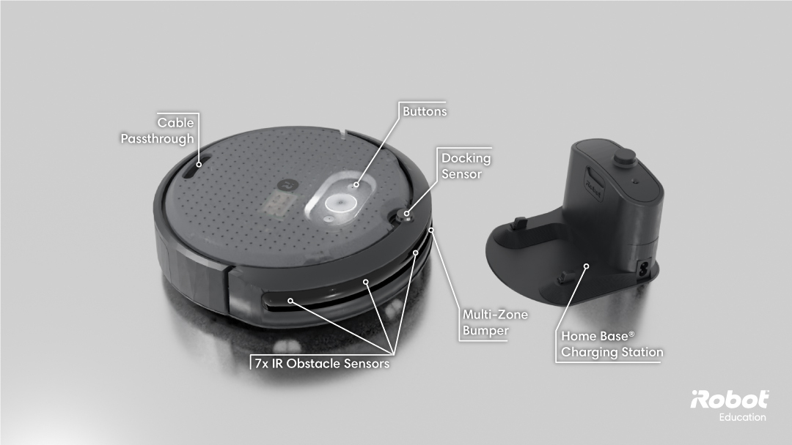
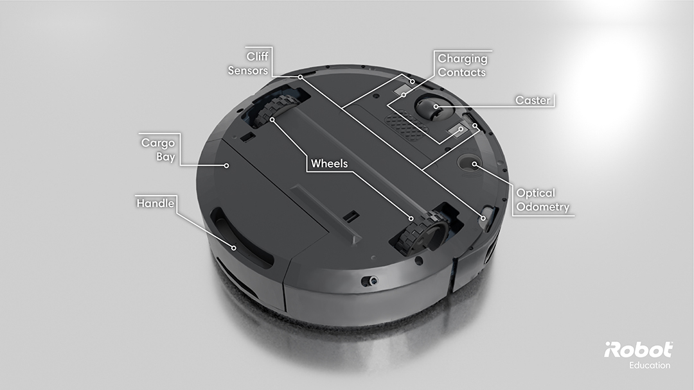

# Sensors

Last time we had our robot navigate to a waypoint.  But how did it know how to get there, or where it was in space?  

It didn't, but you did via the godlike nature of "knowing everything" as part of the simulation.  The robot was able to report its exact coordinates because Gazebo/MuJoCo knew exactly where it was.

Real robots don't have that luxury, however, and must rely on sensor data to figure out where they are.  Think: GPS, triangulating distances from known nodes, etc.

One other glaring omission from navigating to the waypoint was a serious lack of obstacles to get in the way.  As it stands, the robots we programmed would have gladly collided with those obstacles as they have no directive to do otherwise.

Time to resolve that!

## About Sensors

For us, sensors are some nebulous "thing" that returns a value based on its task.  Yes that is a fairly broad and seemingly useless definition, but really anything can be a sensor.  A radar sensor returns the length of time the wave takes to reflect back to the device, providing a potential mapping of an area.  A temperature sensor (of the thermister variety) measures temperature as a function of electrical resistance.  A software sensor may report on the state of internal logic in a controller.

TODO: picture of a sensor

My point is not to trivialize them, mainly pointing out the level of abstraction we are working at.  In simulation they will be essentially perfect reporters of information; though in reality they are far less so.  Plus, designing and/or selecting components for sensors is a non-trivial task and requires a deep knowledge of electrical theory.

We're using them as they come on the robots, so more of a "assume they'll work fine and upgrade them later if not" type of situation.

Now that our expectations are set, how do we use them in ROS?  We have some options - two of which we'll focus on:

1. Consume sensor data directly within the robot's controller.

2. Send out sensor data on a published ROS topic (and potentially still use (1)).

One other thing to consider, since we are mainly in simulation you have free reign to [program your own sensors](https://wiki.ros.org/ethzasl_sensor_fusion/Tutorials/custom_sensor_design).  However, since are plans are to use the same robots that we have in simulation (Create and Crazyflie) we aren't going to be adding custom sensors - unless you're planning on making them in reality as well.

Interestingly, in ROS we'll most likely be *consuming* the sensor data via a ROS topic callback -- (2) involves rebroadcasting it to other nodes.

### Which data management strategy?

Whether you go with (1) or (2) or some combination thereof is entirely up to you and your application.  We'll do both as examples.  We're also going to only use the Create 3 for this example - feel free to extend it for the Crazyflie.

We'll start by reading our sensors that are available and making decisions on them locally.  We'll then broadcast them to a topic so that our central controller can log them.

### Create 3 sensors

As the image below shows, we have a suite of infrared (IR) sensors for detecting obstacles, a bumper sensor array for knowing when we bump into things, a docking sensor to help with locating the docking station.

_[iRobot Create 3 Sensors](https://iroboteducation.github.io/create3_docs/hw/overview/)_

On the underside is an array of cliff sensors to make sure the robot doesn't fall down stairs and an optical odometry sensor (together with an internal IMU - intertial measurement unit) for odometry information.

_[iRobot Create 3 Bottom Sensors](https://iroboteducation.github.io/create3_docs/hw/overview/)_

### Reading data and printing it

First we need to get a handle on *how* to read the data.  [This guide](https://turtlebot.github.io/turtlebot4-user-manual/software/create3.html) lists out all the available topics we can subscribe to (plus some others for the Turtlebot as it shared a common hardware platform as the Create).

> You can also get an up to date list on the [Create's GitHub page](https://github.com/iRobotEducation/irobot_create_msgs/tree/rolling).
{: .prompt-tip }

If we look over that list, we care mainly about these messages:

* HazardDetection
* DockStatus: Information about the robot sensing its dock charging station.
* HazardDetection: An hazard or obstacle detected by the robot.
* HazardDetectionVector: All the hazards and obstacles detected by the robot.
* IrIntensity: Reading from an IR intensity sensor.
* IrIntensityVector: Vector of current IR intensity readings from all sensors.
* IrOpcode: Opcode detected by the robot IR receivers.
* KidnapStatus: Whether the robot is currently kidnapped or not.
* StopStatus: Whether the robot is currently stopped or not.

Each of these relays interesting information.  We can get a quick "OH NO A HAZARD WAS DETECTED" by reading the `HazardDetection` message or get more precise measurements via the `HazardDetectionVector` list.

We're not going to delve into the particulars of each message as that's a documentation lookup exercise for the student.

Why aren't we keeping an eye on the wheel encoders?  We could, though for now we'll assume that we can just command them and they'll do what we want.  However, if we want to be a bit more precise we should keep an eye on them.

Let's go back to our `undock_and_talk` project and print out some data.  

## Homework Extensions

